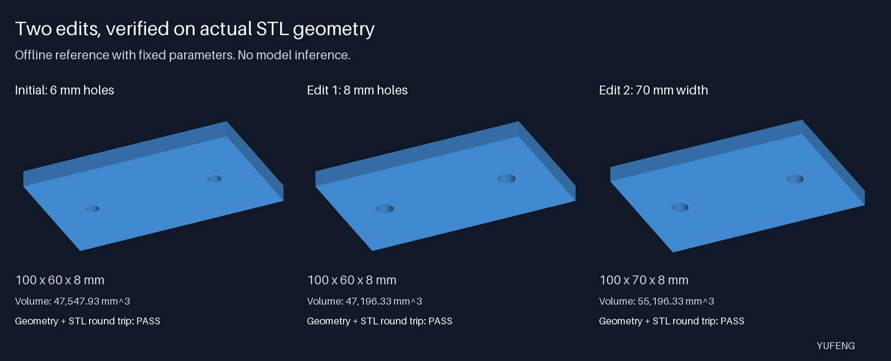

# Kimi K3.1 workflow examples

English · [中文](README_CN.md)

Two small examples for checking what an agent actually preserves and produces:

- A native Chat Completions tool loop that keeps reasoning and tool-call history, checks streamed termination, and records disjoint input/cache/output usage.
- A two-hole plate that is generated as real geometry, edited twice, exported to STL, reloaded and checked against its requirements.

The default run is offline. It uses synthetic SSE fixtures and fixed parameters, not model outputs. No weights, API key, browser, GPU or arbitrary generated code are needed.



## Run from the repository root

Use Python 3.14 for the pinned environment. The local verification used Python 3.14.5 on macOS arm64.

```bash
python3 -m venv .venv
.venv/bin/python -m pip install -r notes/examples/kimi_k31/requirements.txt
.venv/bin/python -m notes.examples.kimi_k31
```

Each run creates a new timestamped directory under `.artifacts/`. To choose a location, pass `--output path/to/new-directory`. An existing target is refused rather than overwritten.

The offline output includes:

```text
offline/report.json
offline/initial.stl
offline/initial.png
offline/larger_holes.stl
offline/larger_holes.png
offline/wider_plate.stl
offline/wider_plate.png
```

The JSON distinguishes synthetic usage estimates from actual API activity. `live_requests` is zero in offline mode.

## What the geometry example checks

The initial plate is 100 × 60 × 8 mm, with two 6 mm through-holes, 60 mm apart and symmetric around the center. The first edit changes only the diameter to 8 mm. The second changes only the width to 70 mm.

The generator accepts exactly five bounded numeric parameters. It uses trimesh and Manifold to construct solids. It does not evaluate model-generated Python, shell commands, file paths or geometry scripts.

Verification operates on the actual mesh, including the STL after export and reload:

- finite vertices, a closed positive volume and one connected body;
- bounds centered at the requested origin;
- two-handle topology and expected volume within tessellation tolerance;
- empty cylindrical probes through the expected holes;
- retained annular wall probes over the full plate thickness;
- unchanged parameters across each requested edit.

The probes use a 0.05 mm radial margin, the cylinder approximation uses 96 segments, and bounds use a 0.001 mm tolerance. These are explicit checks for this bounded example, not a general CAD equivalence proof or manufacturing approval.

Tests include missing holes, wrong pitch with matching volume, oversized holes, blind holes, nonwatertight geometry and a volume-compensated counterbore. That last case has 9 mm openings instead of the requested 6 mm holes while preserving total volume; checking only the middle of the hole wall would miss it.

The preview uses a CPU depth buffer so overlapping triangles are rendered by per-pixel depth rather than triangle-center order. The image is a projection of the generated geometry, not an independent geometry verifier.

## What the protocol example checks

`ChatStream` handles fragmented UTF-8 and JSON, reasoning text, streamed tool arguments and usage-only chunks with empty `choices`. It requires a complete `[DONE]` terminator and a supported finish reason. Truncation and disconnects do not become successful answers.

The sample's one local tool reads a synthetic plate specification. Unknown tools, malformed arguments, unknown assistant/choice fields, conflicting IDs and backwards usage snapshots are rejected. A completed tool message is replayed with its original reasoning and matching call ID.

Usage accounting follows the native Chat contract:

```text
ordinary input = prompt_tokens - cache_read_tokens - cache_write_tokens
input total = ordinary input + cache reads + cache writes
output total already includes reasoning tokens
```

Missing usage stays unknown. Usage updates are cumulative snapshots, not quantities to add together. A decreasing input or output total is an error rather than a free request.

The price table is dated 2026-10-24 and comes from the official international API page. Default 5-minute cache writes have a recorded rate; the 1-hour write rate is intentionally unknown here. If it is needed, the cost result remains incomplete instead of inventing a total. Estimates exclude external tools and are not account billing statements.

## Optional bounded live smoke test

Live mode only uses the native endpoint `https://api.moonshot.ai/v1/chat/completions`. It does not route an OpenRouter key to that endpoint, read credential files, top up an account, switch models automatically or execute generated code.

With a valid native key already supplied through `MOONSHOT_API_KEY`:

```bash
.venv/bin/python -m notes.examples.kimi_k31 --live
```

Default effort is `low` to fit the small smoke-test budget. `--effort high` and `--effort max` are available without increasing the output cap. `--model kimi-k3.1-pro-highspeed` selects the other explicitly supported model.

Before any request, `live/run-config.json` records these ceilings:

| Limit | Maximum |
| --- | ---: |
| Requests, including failed attempts | 6 |
| Requested completion tokens per request | 4,096 |
| Serialized request body | 16 KiB |
| Live workflow wall-clock budget | 600 seconds |
| Conservative cost reservation | USD 2 |
| HTTP retries | 0 |

The normal workflow uses five requests: two for the read-only tool loop and three for the initial plate plus two revisions. Request bodies contain only synthetic public parameters. Credentials are sent only in the authorization header, not prompts or reports; the configured key is redacted from recorded strings.

Cost is reserved before sending, using byte count plus framing margin and rates above the supported models. Failed requests do not refund the reservation. This is a conservative client-side estimate under the published price assumptions, not a provider-side account spending cap.

HTTP redirects are not followed. Per-operation timeouts and an outer workflow deadline cover stalled streams and cleanup. Server failures are not silently retried. A context-close error cannot leave a successful result.

`live/report.json` records model, endpoint, effort, byte count, output cap, elapsed time, raw usage, estimated cost and task checks. Missing usage or an incomplete price calculation prevents an overall accepted run even if task outputs passed. Unavailable credentials and API authorization/quota responses are reported as resource blocks with a nonzero exit code.

Live mode is a protocol and parameter-edit smoke test. It is not BenchCAD, a model ranking, a vision test or evidence that the model generated the underlying geometry kernel. No successful hosted inference result is claimed by the checked-in offline examples.

## Tests and lint

```bash
.venv/bin/python -m pip install -r notes/examples/kimi_k31/requirements-dev.txt
.venv/bin/python -m unittest discover -s notes/examples/kimi_k31/tests -v
.venv/bin/ruff check notes/examples/kimi_k31
.venv/bin/ruff format --check notes/examples/kimi_k31
```

Tests use real geometry operations and local mocked HTTP boundaries. They do not call a hosted model. Temporary test output stays under the repository's ignored `.artifacts/` directory.

## Sources and related upstream work

- [Kimi K3.1 Pro guide](https://platform.kimi.ai/docs/guide/kimi-k3-1-pro-quickstart.md)
- [Native Chat API contract](https://platform.kimi.ai/docs/api/chat.md)
- [International API price source](https://platform.kimi.ai/)
- [Kimi Code issue #4368](https://github.com/MoonshotAI/kimi-code/issues/4368): the reported cache-write counter is lost in two current converters. The issue contains a source-function reproduction, not a claim that a fix has merged.

The code in this directory is covered by its local [MIT license](LICENSE). That license does not relicense third-party source material or the repository's older notes.
